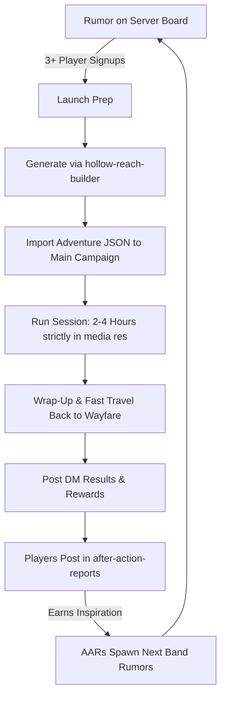
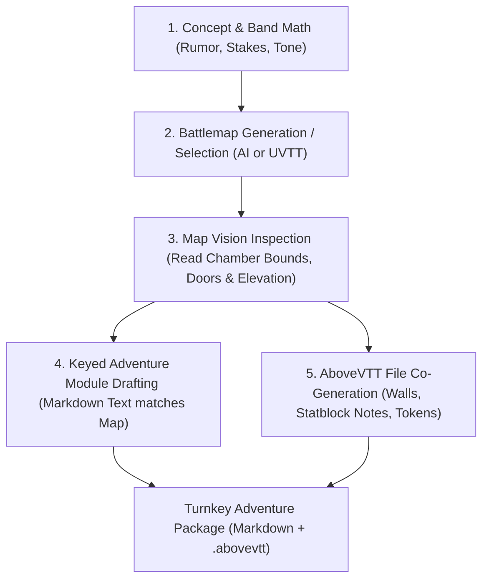

# Hollow Reach Adventure Builder: Rapid West Marches One-Shot Engine

This skill automates the creation of modular, high-tension, 2-to-4-hour one-shot adventures tailored for the **Hollow Reach** West Marches campaign (centered around the hub town of **Wayfare**).

It synthesizes:
- **Johnn Four's 5-Room Dungeon** overlaid with **Syd Field's Three-Act Screenwriting Structure** and an abridged **Hero's Journey**.
- **Justin Alexander's Dynamic Dungeons**: Adversary Rosters with active mobility stances (*Patrol*, *Mobile*, *Stationary*) and 1-in-6 adjacent room alert triggers.
- **The 30/20 Combat Rule**: Hard capstone encounter CR math (CR ≤ 1.5 × APL), tactical enemy behaviors informed by `themonstersknow.com`, and a ≤ 50% HP bloodied morale parley/retreat engine.
- **Tactile Challenge Design**: Traps, locks, and secrets engineered as multi-layered, interactive physical scenes (Clue → Interaction → Teamwork/Solution) using the **3-Clue Rule**, with ability checks serving as safety nets rather than progress-blocking gates.
- **Strict Session Economy**: Designed specifically to wrap in **2 to 4 hours** with **at most 4 primary encounters** (ideally 2 combat + 2 exploration/puzzle/roleplay), plus 1 optional return ambush buffer.

---

## 1. West Marches Operational Flow (Hollow Reach Lifecycle)



### The 6 Golden Rules of Hollow Reach Prep:
1. **Greenlit by Signups:** An adventure is only prepped after a rumor gets 3+ interested players.
2. **Fast Travel & *In Media Res*:** Assume the party fast travels from Wayfare to the adventure site. Start the session *in media res* at the entrance threshold.
3. **Pacing Guarantee:** Keep the primary adventure to **4 encounters maximum** (no more than 3 combat; target 2 combat + 2 exploration/puzzle/social).
4. **Teamwork Over Heroics:** Every puzzle, obstacle, and secret requires cooperation or pairs (e.g., hold a lever while another prying a stone; shield cover while picking a lock). Success or failure is party-wide.
5. **Emergent Server Storytelling:** Adventure outcomes must ripple into Wayfare. Player writeups in `#after-action-reports` grant inspiration and directly inspire the next band's rumors.
6. **Clean VTT Workflow:** Build in a separate blank campaign/folder → export as `.json` → import into the main campaign on game day → archive and delete the folder after the game.

---

## 2. Modes of Operation & The Map-First Principle

A great DM workflow begins with a **strong premise**, immediately followed by the **battlemap**. The map's spatial architecture (its chokepoints, elevation changes, chambers, and natural contours) leads and inspires every subsequent encounter, trap, secret, and tactical element.



### The "Unified Ingress-Dungeon-Egress" Canvas Standard (Single-Scene Lifecycle)

The gold standard for AboveVTT one-shot design is a **single unified operational canvas** that integrates the outdoor entrance staging and the interior dungeon complex onto one contiguous battlemap:

```
┌────────────────────────────────────────────────────────────────────────────────────────┐
│                        UNIFIED SINGLE-SCENE BATTLEMAP CANVAS                           │
├──────────────────────────────────────────┬─────────────────────────────────────────────┤
│   EXTERIOR STAGING & AMBUSH ZONE         │   INTERIOR 5-ROOM DUNGEON COMPLEX           │
│   • Marsh catwalks / skiff dock          │   • Room A2 (Puzzle / Sluice Keep)          │
│   • Surface trail / mausoleum landing    │   • Room A3 (Trick / Cistern Hazard)        │
│   • Phase 1: Ingress & Token Staging     │   • Room A4 (Climax / Sepulcher Boss)       │
│   • Phase 3: Egress & Return Ambush      │   • Room A5 (Secret / Reliquary Vault)      │
└──────────────────────────────────────────┴─────────────────────────────────────────────┘
```

#### Canvas Sizing & Viewport Standards (50 px Grid Pitch):
* **Baseline "Zero-Scroll" Scale (28 × 16 squares / 140' × 80'):**
  - Dimensions: $1400 \times 800\text{ px}$ at $50\text{ px / square}$.
  - Ideal for tight, claustrophobic delves, sunken caverns, crypts, and vertical shafts.
  - **The Zero-Scroll Advantage:** Fits comfortably on 1080p and 1440p displays with AboveVTT sidebars open. Players and DMs never need to pan, zoom, or search for off-screen tokens during combat.
* **Expanded Scale (Up to Double / 56 × 32 squares / 280' × 160'):**
  - Dimensions: Up to $2800 \times 1600\text{ px}$ at $50\text{ px / square}$.
  - Ideal for expansive outdoor wilderness approaches, wide marshlands, forest glades, and multi-tier surface ruins.
  - **Counteracting Range Compression:** Small maps create "range compression"—they inadvertently buff 30-ft close-range abilities (thrown daggers, short cones, 30-ft cantrips) because everything is within a single Dash, while completely neutralizing long-range investments (Longbows at 150/600 ft, Heavy Crossbows, *Eldritch Spear*, Spell Sniper). 
  - An expanded canvas gives long-range snipers, scouts, and fast skirmishers (Monks, Rogues, mounted PCs) meaningful space to exploit kiting, staggered retreats, and long-range sightlines before melee closes.
  - Preserves the clean 16:9/16:10 aspect ratio and strict integer grid alignment without blurry texture scaling.

#### Multi-Tier Surfaces & Vertical Tactical Elevation (Balconies, Catwalks, Mezzanines):
Battlemaps gain massive tactical depth when chambers feature **multi-tier surfaces** (raised wooden catwalks, stone balconies, mine scaffolding, hanging mill races, elevated daises, or cliff ledges):
* **Asymmetric Cover & Sightlines:** Creatures on an elevated tier firing down over wooden railings or stone balustrades gain half cover (+2 AC) or three-quarters cover (+5 AC), while creatures below must expose themselves to aim upward.
* **Vertical Forced Movement (Gravity as a Weapon):** Shoving, bull-rushing, or blast-pushing foes off catwalks deals standard falling damage ($1\text{d}6$ bludgeoning per $10\text{ ft}$) and leaves the target prone on the floor below—setting them up for melee allies.
* **Chokepoint Control & Ladder Mechanics:** Catwalks accessed by ladders or narrow stairs create natural defensive bottlenecks. Players or foes can sever ropes, topple ladders (Athletics DC 10), or dump boiling oil/flour sacks from above onto bottlenecked climbers.
* **Plunging Strikes & Traversal Stunts:** High perches enable cinematic player actions: swinging across on cargo pulleys (DC 12 Acrobatics), plunging down with a descending strike to split falling damage with an enemy, or using *Misty Step* / *Levitate* to bypass ground hazards.

#### Why the Unified Canvas is Superior:
1. **Zero Scene Switching:** The DM never has to switch scene tabs in AboveVTT, wait for texture re-loads, or re-select and migrate player tokens between separate maps. The entire 2-to-4-hour session runs on a single, continuous board.
2. **Full Lifecycle on One Map:**
   - **Ingress:** The session opens *in media res* on the outdoor boardwalks, trail, or mausoleum landing where the party arrives (skiff docked, mounts hitched).
   - **Infiltration & Climax:** The party breaches the threshold doors, delving into the interior chambers (A2–A5) guided by dynamic fog-of-war and line-of-sight walls.
   - **Egress & Ambush:** When the party secures the relic/charter and falls back to their extraction point, the DM immediately triggers the return buffer ambush on the exterior threshold—using pre-placed, hidden adversaries already on the board.
3. **Diegetic Immersion & Continuity:** Players physically see their extraction boat or horses waiting outside the doorway while fighting inside; the dungeon feels anchored to the surrounding wilderness rather than floating in a void.
4. **WebGL & Memory Performance:** Streaming a single 50 px grid canvas (e.g. 1400 × 800 px, ~350 KB) guarantees instant loading and butter-smooth browser performance with zero canvas re-initialization stutters.

### Mode A: Interactive Co-Pilot (Default)
The agent acts as a creative partner, guiding the DM through a snappy 5-phase dialogue:
1. **Intake & Band Math:** DM provides party band/level, player count, and starting rumor/hook. Agent confirms CR caps and time budget.
2. **Concept & Dramatic Question:** Propose the 3-act narrative arc (Inciting Incident → Rising Confrontation → Resolution) and hidden conspiracy/twist.
3. **Map-First Generation / Selection:** Generate or select the top-down battlemap first (via `image-generator` or Watabou/UVTT).
4. **Visual Geometry Inspection & Keying:** Inspect the rendered map image to determine true chamber dimensions, door openings, stairs, and natural features, assigning Areas A1 through A5 to real visual spaces.
5. **Turnkey Drafting:** Draft the keyed adventure markdown module and co-generate the AboveVTT export file simultaneously against the real visual geometry.

### Mode B: Express Generator
The DM provides a single prompt:
`Generate adventure: [Band Level, e.g., Greenhorns Lvl 2], [Rumor Hook, e.g., Sunken crypt beneath Miller's Creek], [Tone/Tags, e.g., flooded, ancient, ghouls]`
The agent executes the full Map-First pipeline autonomously: generates concept → renders battlemap → inspects map geometry → drafts markdown module with scene art → compiles `.abovevtt` file.

---

## 3. Structural Mapping Blueprint

### Everything's a Dungeon
Remember, **everything's a dungeon**—whether it's a small town, forest glade, abandoned farm, flooded cavern, or ruined mill. Any locale can be treated as a 5-room-dungeon.

### Description, Locale, and Layout
* **Stage & Environment:** Set the tone, the stage, and the environment, including terrain, lighting, ambience, flora, fauna, and the location’s history and current use (whether it’s a natural environment, a wonder, a ruin, or a hybrid).
* **Single Consistent Encounter Space:** Whether it’s one large open area or several connected chambers, the layout should support **one consistent encounter**. Even if there are several enemy groups, it should be difficult to engage them completely independently—actions alert adjacent zones, most often leading to one large, dynamic conflict. If this is a lair, base of operations, or hideout, enemies must actively use the terrain to their tactical advantage.
* **No Wasted Background:** The history and current use may be obvious from the initial description, from previous rumors, or discovered through exploration. **Don't bother writing a background that won't see gameplay, can't be discovered, or has no impact on the layout.**
* **Band Appropriate:** Locales and challenges must match the party's band tier (Greenhorns L1–3, Blooded L4–6).

### Enforced Order in Jaquayed Maps
Use maps with **multiple ingress points and loops** to avoid railroaded encounters, but use **locks, secrets, puzzles, riddles, spells, tricks, and traps to ensure the capstone of a quest doesn't come first**. 
* **Reward Tactical Scouting:** Reward players for finding the best way to approach, like a "back door" or secret chimney/drainage entrance that makes gaining surprise trivial.
* **Breathing Room (Negative Space):** Include spaces to search that don't immediately trigger jump scares or ambushes. Giving players room to inspect forensic clues, rotted machinery, and environmental textures without pressure makes subsequent jump scares and combat spikes significantly more prominent.

---

### The 6 Core 5-Room Flow Archetypes
Classic abbreviations:
* **E** = Entrance (Threshold / Sentry)
* **P** = Puzzle or roleplay challenge
* **S** = Setback or twist
* **B** = Big battle (Capstone conflict)
* **R** = Reward or revelation

```text
💠 LINEAR (Classic sequential crawl)
E ──► P ──► S ──► B ──► R

🐓 ROOSTER (Divergent probe & reward branch)
      P
       \
  E ──► S ──► B
       /
      R

❌ CROSS (Central hub with 4 cardinal wings)
      P
      │
  S ──┼── B
      │
      R
  (Entrance E at center hub)

🕊️ FLYING V (Twin investigative wings converging on capstones)
  B           R
   \         /
    S ───── P
         │
         E

🔀 DECISION (Forked climax based on player stance or choice)
        B
  E ──► P ──► S
        R

🔁 WRONG WAY (Immediate cold-open setback before true entry)
  S ──► E ──► P ──► B ──► R
```

| Flow Archetype | Best Suited For | How Jaquaying & Gating Enforce Order |
|---|---|---|
| **💠 Linear** | Tight subterranean shafts, aqueducts, linear crypt descents. | Elevation drops or collapsed portcullises enforce forward drive; secret loop connects R back to E. |
| **🐓 Rooster** | Bandit lighthouses, mill towers, fortified homesteads. | The main thoroughfare drives E → S → B, but scouting reveals an upper loft or side flume with the puzzle (P) or hidden safe (R). |
| **❌ Cross** | Central town squares, crossroads, ruined keeps, domed temple hubs. | E drops into a central atrium. Locks or environmental hazards block B until clues in P and S are solved. |
| **🕊️ Flying V** | Dual-faction sites, bifurcated cave systems, flooded quarries. | E splits into two wings: one leads through the setback (S) to the boss (B); the other through the puzzle/parley (P) to the cache (R). |
| **🔀 Decision** | Moral dilemmas, faction bases, contested relics. | S presents the moral or tactical fork: side with the victim (unlocking R peacefully) or execute the contract (triggering B). |
| **🔁 Wrong Way** | Trapped fake entrances, ambushed approaches, collapsed bridges. | The players trigger the setback (S) before ever setting foot in the true entrance (E)—e.g., sinkhole collapses beneath their camp. |

---

### 5-Room Structural Matrix

| Room | 5-Room Archetype | 3-Act Structure | Hero's Journey | Mechanical Purpose |
|---|---|---|---|---|
| **A1** | **Entrance / Guardian** | Act 1: Setup | Crossing the Threshold | Establishes atmosphere, *in media res* stakes, and tests party readiness with a low/mid combat sentry or environmental barrier. |
| **A2** | **Puzzle / Challenge** | Act 2: Rising Action | Tests & Trials | Non-combat encounter engaging the whole party (Athletics, Arcana, Social, Tools). Implements the **3-Clue Rule**. |
| **A3** | **Trick / Setback** | Act 2: Complication | The Approach / Complication | A sudden revelation, hazard, betrayal evidence, or resource drain that subverts expectations and raises the stakes for the climax. |
| **A4** | **Climax / Big Conflict** | Act 3: Confrontation | The Ordeal | The capstone battle. High tactical difficulty with terrain favoring the villain. Enemy uses `themonstersknow.com` tactics and checks bloodied morale at ≤ 50% HP. |
| **A5** | **Reward / Revelation** | Act 3: Resolution | The Return Home | Tangible loot protected by a **Layered Trapped/Locked Secret**, plus the critical evidence/item that answers the session's dramatic question and seeds future rumors. |
| **Bonus** | **Return Ambush** | Epilogue Buffer | Road Back | Optional chokepoint encounter deployed *only* if the party finishes in under 2 hours. Focuses on escape routes and tactical terrain. |

### The Injustice & Restitution Spine (The Soul of the Adventure)

An adventure gains **lasting emotional investment and "teeth"** when players don't just clear rooms for gold, but **experience someone else's pain and visceral injustice, and become driven to right the wrong**:

1. **The Discovered Wound (Room 1 — Crossing the Threshold):** The official rumor or employer's narrative shatters immediately upon arrival. The party discovers visceral proof of human suffering—a defaced knight's cenotaph reading *"COWARD"*, weeping voices repeating dead homesteaders' names, or living roots crying out from burnt sap. The quest ceases to be a job and becomes a personal reckoning.
2. **Unmasking the Lie (Rooms 2–3 — Tests & Complications):** Navigating the hazards and puzzles unearths concrete physical proof of institutional betrayal—sabotaged gears stamped with a founder's crest, forged treaties, or secret ledgers proving that town authorities built their wealth on murder and stolen credit. The players realize their employers hired them as cleanup crews to erase evidence.
3. **Confronting the Martyr (Room 4 — The Ordeal):** The climax is not a mindless slugfest against a villain—it is an encounter with a **tormented victim of the founding sin** (Aveline entombed alive, Maeve pinned by the anchor, the Heartwood Woad guarding an alderman's dying wish). Through the **d6 Lore Parley Engine** (triggered at $\le$ 50% HP or via true names), the victim pours out their grief directly into dialogue. The players face a profound moral choice: butcher the victim to claim the corrupt bounty, or risk their lives to break the victim's chains and champion their cause.
4. **The Weapon of Truth & Restitution (Room 5 — Seizing the Sword):** Beyond gold, the central reward is the **instrument of justice**—the unedited founding charter, the true territorial grant, or the secret timber ledger—that can dismantle the oppressors' power in Wayfare. In gratitude, the cleansed spirit grants the party an enduring ancestral blessing before dissolving into peace.
5. **The Beneficiaries' Ambush (Buffer Ambush — The Road Back):** The corrupt authorities who profit from the lie (Council enforcers, crooked bailiffs, river wardens) ambush the party at their extraction point to bury the truth. Defeating them cements the players as true folk heroes who didn't just survive a dungeon—they redeemed a piece of the world.

### The Mystery Engine: Discovery of Intent & Earned Conviction

If the truth is spoon-fed or declared by an NPC in the first room, the narrative feels shallow and unearned. True emotional investment requires **active forensic investigation and the progressive discovery of calculating intent**. When players deduce the conspiracy with their own minds, their righteous conviction carries real moral weight:

```
┌────────────────────────────────────────────────────────────────────────────────────────┐
│                        THE 3-TIER FORENSIC MYSTERY HIERARCHY                           │
├─────────────────────────┬──────────────────────────────┬───────────────────────────────┤
│ 1. THE FORENSIC ANOMALY │ 2. THE MODUS OPERANDI        │ 3. THE DISCOVERY OF INTENT    │
│ (Physical Contradiction)│ (The Mechanical Method)      │ (The Calculating Motive)      │
├─────────────────────────┼──────────────────────────────┼───────────────────────────────┤
│ • Pry marks on inside   │ • Warding spike is a siphon  │ • Stolen dynasty legitimacy   │
│ • Scorch marks run in   │ • Sluice wedged with crest   │ • Port silts up if freed      │
│ • Barbed thorns, not axe│ • Double-entry tax ledgers   │ • Skimming 40% timber profits │
│ Action: [Search]        │ Action: [Study]              │ Action: [Influence] & Parley  │
│ "Someone is lying."     │ "This was an execution."     │ "We are the reckoning."       │
└─────────────────────────┴──────────────────────────────┴───────────────────────────────┘
```

#### The 3 Investigative Tiers:
1. **Tier 1: The Forensic Anomaly (Physical Fact — `[Search]`):**
   - A physical contradiction that directly disproves the employer's official cover story.
   - *Examples:* Pry marks on the *inside* of a marble sarcophagus while iron straps are bolted from the *outside*; cinerary urns overturned from within; logging draft horses killed by thorny spines rather than wild beasts.
   - *Player Deduction:* *"The official story is a complete fabrication."*
2. **Tier 2: The Modus Operandi (The Method — `[Study]`):**
   - Uncovering the mechanical or arcane engineering used to commit and conceal the betrayal.
   - *Examples:* Necrotic glyphs proving the warding spike channels soul energy into town foundations; drainage valves intentionally wedged shut with iron chisels bearing the founder's personal stamp; secret double-entry ledgers hidden behind false coffer panels.
   - *Player Deduction:* *"This wasn't a tragedy or accident—it was a premeditated institutional execution."*
3. **Tier 3: The Discovery of Intent (The Motive — `[Influence]` & Lore Parley):**
   - Unmasking the cold economic or political motive behind the crime through environmental documents and the **d6 Lore Parley Engine**.
   - *Examples:* The founder buried his partner alive to steal the settlement's charter rights for his lineage; the Council keeps the drowned warden chained because releasing her turns their artificial deep-water harbor back into mud flats; Lady Korena sent loggers to burn her husband's treaty to protect her timber monopoly.
   - *Player Deduction:* *"Our employer hired us as unwitting janitors to bury their guilt. We will not be their cleanup crew."*

#### The 3-Clue Redundancy Rule (Alexander):
For every critical deduction, embed at least **3 distinct clues** across different chambers and action lenses (one physical anomaly, one written/mechanical record, and one creature reaction). Investigation never grinds to a halt on a single failed d20 roll; checks determine the *speed and detail* of deduction, never access to the clue itself.

---

## 4. Encounter Mechanics & Math Standards

### 1. Encounter Scene Structure & Pillar Fluidity
* **Scene-Based Pacing:** Run each encounter like a story or a scene, with a clear **objective, beginning, middle, and end**. Every encounter features a **locale, conflict, and reward** (treasure, survival, leads, or clues).
* **Locale Inside Locale:** Just as the adventure has a master locale, each encounter has its own distinct micro-locale (e.g., a swamp hiding a submerged cave mouth, or vertical staging up a ruined mill tower).
* **Three-Pillar Fluidity:** The conflict may use one or more of the Three Pillars—often driven by player choice:
  - Enemies employ traps or obstacles against the party, or use hostages for barter.
  - Encounters frequently transition between pillars: an enemy can be reasoned with (Combat → Social), an allied NPC turns hostile (Social → Combat), or disarming an arcane trick/trap releases captives or neutralizes an environmental threat (Exploration → Social).

### 2. Number and Difficulty of Combat Encounters (The 30/20 Rule)
If an adventure only has **two combat encounters**, they should be **middle to upper band with circumstances that favor the enemy**:
* **Greenhorns (Levels 1–3):** CR 2–3 guardian; CR 4–5 primary villain (with minions).
* **Blooded (Levels 4–6):** CR 3–5 guardian; CR 6–8 primary villain (with tactical lair advantage).

```text
Max Capstone CR = 1.5 × APL (Average Party Level)
Formula: The max CR for a single creature against a 20th-level party is 30;
thus the max a 10th-level party should face is 15 (3/2 × APL).
```

* **Multiple Enemies:** Use encounter multipliers for multiple enemies and cross-check the adjusted XP/CR against the 30/20 cap.
* **Higher Capstones & Earned Allies:** If the capstone CR exceeds this threshold, provide clear, diegetic ways for the PCs to recruit allies or turn factions—**avoid deus ex machina (no eagles!)**.
* **Watch Out for Character Killers:** Beware of swingy, low-level TPK monsters (e.g., banshees, shadows, intellect devourers, bodaks) whose abilities can insta-kill PCs regardless of HP pool.

### 3. The Game-Day APL Dial (Modular Follower & Minion Scaling)
In an open-table or West Marches campaign, party strength fluctuates significantly within a band (e.g., Greenhorns ranges from 3 fragile Level 1 PCs up to 5 seasoned Level 3 PCs with subclasses and feats). 

**Never tune an encounter as a rigid, monolithic stat block to the upper end.** Doing so risks an unfair TPK on a low-level table, while tuning it down makes it trivial for veteran characters. Instead, use the **Game-Day APL Dial**:

* **The Anchor + Followers Architecture:** Build encounters with one **Anchor Creature** (the boss or guardian) accompanied by **Modular Followers / Minions (CR 1/8 to 1/2)**.
* **Pre-Placing Hidden in AboveVTT:** All modular follower tokens are pre-placed on the VTT canvas set to `hidden: True`. The DM dials the encounter at game time simply by choosing how many tokens to unhide:
  - **APL 1 (or 3 PCs):** Anchor only (or Anchor + 1 minion). Lower single-target spike damage.
  - **APL 2 (Standard 4 PCs):** Anchor + 2 minions. Balanced action economy.
  - **APL 3 (or 5+ PCs):** Anchor + 3–4 minions (or deploy 2 minions as a round 2 flanking reinforcement).
* **Bookend Combat Pacing (Start with a Bang, Climax at Extraction):**
  - **Opening Bang (Room 1):** Immediate combat establishes high energy and physical stakes *in media res*.
  - **The Delve & Social Core (Rooms 2–4):** Puzzles, forensics, hazard navigation, and a deep social parley with the anchor villain/martyr.
  - **The Guaranteed Climax (Extraction Ambush):** Even if the party uses brilliant diplomacy, empathy, or stealth to peacefully resolve the boss without rolling initiative, **the session never fizzles into an anticlimax**. The return ambush at the extraction threshold ensures a climactic, hard-fought battle to earn their way home.

### 4. Circumstances that Favor the Enemy (Tactical Advantage Checklist)
To make encounters dangerous without inflating hit point sponges, always build in circumstances that favor the enemy:
- **Hidden to Gain Surprise:** Ambushes from ceiling fissures, submerged mud, or false walls.
- **Terrain Advantage:** Three-quarters cover, arrow slits, natural bottlenecks, or elevation perches.
- **Environmental Immunity:** Hazardous terrain the enemy is immune to (e.g., ghouls fighting in poison gas or water elementals in rushing rapids).
- **Teamwork & Convergence:** Multiple creatures converge from different angles and use pack tactics or focus fire.
- **Ingress/Egress Flanking:** Enemies utilize secondary tunnels or secret doors to slip behind the party's backline.
- **Barricaded Ranged Threats:** Ranged adversaries firing from behind a locked portcullis or chasm ledge.
- **Villain-Operated Traps:** A hidden pit trap, deadfall, or floodgate the villain can trigger while the players stand on it.

### 4. Morale, Surrender & Defection (≤ 50% HP)
* **No intelligent creature wants to die.** Once a smart creature has been seriously injured (losing more than half its hit points), it attempts to reason with its foes:
  - Offers treasure, hidden keys, or secret ledgers in exchange for its life.
  - Betrays its employer with critical intelligence.
  - **Allies may defect:** Intelligent underlings or mercenaries may switch sides or flee the moment the boss is bloodied.
* Use `themonstersknow.com` to inform enemy tactics and predatory behaviors.

### 5. Multi-Class Exploration Challenges & The 3-Clue Rule
With layouts that feature loops and alternate ingresses, to keep the highlight encounter from occurring too soon, use **locks, secrets, puzzles, riddles, spells, tricks, and traps to ensure the capstone comes last**:
* **The 3-Clue Rule:** Every secret, riddle, or investigative deduction must have at least **3 distinct clues** (one physical anomaly, one mechanical/written record, one NPC/creature tell).
* **Avoid TPK Traps:** Hazards and traps that only serve to do flat damage are unsatisfying. Combining traps and puzzles with tangible rewards or reveals is far more engaging.
* **Engage the Entire Party:** The best challenges require cooperation across multiple character roles—not just the rogue picking a lock or the wizard casting *identify*. Incorporate at least two of the following into major obstacles:
  - *Persuasion:* Convincing a reluctant spirit or prisoner to share the combination.
  - *Athletics:* Climbing a treacherous overhang to reach an overhead lever, or prying a rusted blast door.
  - *Acrobatics:* Crossing a roaring sluice or chasm with pole jumps or tightrope balance.
  - *Arcana / Spells / Ranged Stunts:* Using *Mage Hand* or an expert bowshot to trip a lever through a locked iron portcullis.
  - *Sensory / Environmental Triggers:* Runes that can only be read with Darkvision, or glyphs revealed only by exposure to flame or water.
* **Encourage Creativity (Default to Yes):** Always be open to alternate player solutions instead of stifling ingenuity.

### 6. Interactive Dressing Catalog (Exploitable Mundane Props)
Every keyed chamber must include at least **three seemingly mundane items** that players can weaponize, ignite, topple, or use for cover:

* 🪑 **Common Furniture & Market Goods:** Barrels & crates (cover, rolling hazards, barricades); tables & benches (flipped for cover, bridging gaps); rugs & tapestries (concealing pits, smothering fire, dropping caltrops); curtains & dividers (concealment, smoke screens); mirrors (distraction, periscopes, light reflection); carts & wheelbarrows (mobile cover, noisy diversions).
* 🌾 **Storage & Trade Goods:** Sacks of grain/flour/rice (burst for obscurement clouds or flour explosions); lantern oil jugs (flame hazards, slippery slicks); coils of rope/netting (tripwires, dropping from above); blankets & cloth rolls (smothering flames, muffling alarm bells).
* 🔧 **Workshop / Smithy:** Anvils (heavy obstacles, gravity deadfalls); tongs & tools (improvised weapons, handling hot objects); hot coals & forges (shoving zones for fire damage); buckets of water (quenching fires, creating blinding steam).
* 🍗 **Tavern / Kitchen:** Skewers & knives (thrown weapons, door wedges); cauldrons (scalding liquids, concealing items); kegs (bowling attacks, rolling barriers); spices & chili powder (thrown into eyes for blinding).
* 📚 **Library / Study:** Bookshelves (toppled for barricades or crushing lines); ink pots (obscuring vision, slippery flagstones); scroll racks (flammable barriers, improvised clubs); candles & braziers (fire sources, thrown fire hazards).
* 🏰 **Religious / Ritual Space:** Censers (reach flails, smoke screens); holy water basins (splashed for radiant damage vs. undead/fiends); statues (toppled onto foes or mechanisms); prayer mats & kneelers (concealing pressure plates).
* ❄️ **Cold Climate / Outdoors:** Icicles & stalactites (dropped as falling weapons); snowbanks & mudbanks (concealing movement or traps); firewood piles (barricades, instant bonfires); frozen buckets/pools (shattered for slippery ice zones).

---

## 5. Master Output Format

When generating an adventure document, use this standardized Markdown schema:

```markdown
---
audio:
  ambient: "ambient dark"
  combat: "battle"
  triumph: "triumph"
---

# [Adventure Title]

**Location:** [Sub-region west/east/south of Wayfare]  
**Band & Level:** [e.g. Greenhorns (APL 2)] | **Estimated Play Time:** 2–4 Hours  
**Audio Control:** [▶ Ambient](http://localhost:26796/trigger?playlist=ambient+dark) | [⚔ Combat](http://localhost:26796/trigger?playlist=battle) | [🏆 Triumph](http://localhost:26796/trigger?playlist=triumph)  
**Map Link:** [Wyrmbox direct download URL or seed tags]  

---

## Adventure Synopsis & Narrative Arc
- **The Hook & Inciting Incident:** [The public rumor posted in Wayfare and why players signed up].
- **The Hidden Truth:** [The underlying conspiracy, crime, or forgotten history causing the crisis].
- **The Dramatic Question:** [The core question answered at the climax: e.g. "Can the party seal the reliquary before the shade awakens?"]
- **Pacing & Encounter Budget:** 4 primary rooms (2 combat, 2 non-combat) + 1 optional return ambush.

---

## In Media Res Opening
> [2–3 evocative, scripted sentences placing the party directly at the threshold of the site, already geared up after fast traveling from Wayfare.]

---

## Keyed Encounter Areas

### [Area Code, e.g. A1]. [Room Name] — [Role, e.g. Guardian / Threshold]
**DM Info:**
- **Dimensions & Space:** [Footprint, ceiling height, elevation, exits].
- **Terrain & Lighting:** [Footing, light level, difficult terrain, water depth].
- **Acoustics & Bleed:** [Ambient sound, propagation to adjacent rooms, stealth modifiers].

> **Read-Aloud:**
> [Scripted, flowing narrative prose in complete sentences (following the TSR / WotC gold-standard like White Plume Mountain). Naturally integrate the chamber dimensions and architectural footprint into the first sentence—e.g. "This long stone chamber stretches 30 feet wide and 70 feet south beneath a heavy 15-foot vaulted ceiling..." Weave sight, sound, smell, and temperature directly into the description without bulleted lists or spoilers.]


**Gated Observations:**
- **Passive Perception [DC]:** [Tangible clue or subtle sensory warning].
- **Investigation / Arcana / History [DC]:** [Deduction regarding recent events, traps, or lore].
- **Insight [DC]:** [Motive or emotional state of occupants or dead figures].

**Interactive Dressing (3+ Objects):**
1. **[Object 1]:** [Tactile description and improvised combat/utility stunt].
2. **[Object 2]:** [Tactile description and improvised combat/utility stunt].
3. **[Object 3]:** [Tactile description and improvised combat/utility stunt].

**Adversary Roster & Tactics:** *(Omit if non-combat)*
- **Creature(s):** [Name, CR, Count, Action Group: Patrol / Mobile / Stationary].
- **Tactics:** [Home-turf advantage, target priority from themonstersknow.com].
- **Morale Engine (50% HP):** [Parley offer, surrender condition, or tactical retreat].

**Layered Challenge / Secret:** *(If present)*
- **Clue:** [Visible hint].
- **Interaction:** [Physical testing].
- **Solution:** [Tactile or teamwork resolution].

---

[Repeat for A2: Puzzle/Challenge, A3: Trick/Setback, A4: Climax/Conflict, A5: Reward/Revelation]

---

## Buffer Ambush: [Encounter Name]
*(Deploy only if session wraps in under 2 hours)*
- **Trigger & Locale:** [Transit chokepoint between the dungeon and Wayfare].
- **Enemies:** [Adversaries sent to erase evidence or claim the bounty].
- **Tactical Terrain:** [3+ terrain features: felled trees, high ground, bridge railings, overhead rocks].
- **Alternate Win Conditions:** [Fleeing to Wayfare, causing a rockslide, capturing the leader].

---

## Post-Adventure Server Pack (Wayfare Echoes)

### 1. DM Session Log & Rewards
- **Base Coin & Magic Items:** [Itemized rewards].
- **Civic Favor / Faction Standings:** [Reputation changes with Mayor Andrel, Guilds, or Wayfare factions].

### 2. Player After-Action Report (AAR) Prompt
> *"Post your character's perspective in `#after-action-reports` to earn 1 Inspiration for your next expedition! Tell Wayfare what you saw beneath Stillwater Hollow..."*

### 3. Server Rumor Ripple Effects (Seeds for Next Sessions)
1. **[Rumor Seed 1]:** [Immediate local consequence of their success/failure].
2. **[Rumor Seed 2]:** [Conspiracy ripple involving authorities or rival factions].
3. **[Rumor Seed 3]:** [An intact sister site discovered elsewhere on the map].
```

---

## 6. VTT Integration & AboveVTT Schema Compliance

When generating or preparing `.abovevtt` export files programmatically:
1. **Base64 Encoding:** The `.abovevtt` file must be a base64-encoded UTF-8 string containing the root campaign JSON.
2. **Pure 90° Orthogonal Cartography & Strict Uniform Grid Tiling:**
   - Always prompt battlemaps as **strictly 90-degree orthogonal overhead bird's-eye view** on a pure black exterior void (zero isometric tilt or vertical perspective).
   - Reserve 3D perspective / 2.5D isometric rendering exclusively for narrative scene handouts and chat splash art.
   - **Visual Style Benchmark ("Neutral Party" Aesthetic):**
     - Aim for a grounded, hand-painted tabletop cartography style inspired by **Neutral Party**: earthy, naturalistic color palettes (mossy slate, dark mud, weathered timbers), subtle atmospheric lighting and weather sheen (rain puddles, soft fog, cold stone), and organic environmental storytelling props (fallen logs, crooked headstones, rusted ironwork).
     - Keep textures painterly and clean, avoiding hyper-saturated glows or visual clutter that obscures tokens or conflicts with the AboveVTT digital grid.
   - **Strict Uniform Integer Grid Tiling Rule ($X \times X$ Snapping):**
     - Organic AI-generated dungeon maps naturally exhibit fractional scaling drift from chamber to chamber (e.g. a room rendering at 5.1 squares wide or 6.9 squares tall), causing VTT grids to drift out of sync across different sections of the dungeon.
     - To eliminate drift and ensure zero offset `(0, 0)` across the entire map, **normalize each room independently** before assembling the composite: crop each chamber and resample/scale its dimensions to exact integer multiples of the chosen grid pitch $X \times X$ (e.g., 50 px or 70 px per 5-ft square).
     - Composite all chambers, corridors, and stairs onto the canvas snapped strictly to exact integer grid line boundaries (`x % X == 0`, `y % X == 0`).
     - **The Unified Ingress/Dungeon/Egress Canvas Rule:** Always render the exterior staging area (such as the marsh boardwalks, surface trail, or descending mausoleum landing, at least 2 × 3 or 2 × 4 squares) contiguous on the very same canvas as the interior complex. This single-scene layout hosts the entire adventure lifecycle: staging player tokens for ingress, running the interior dungeon crawl, and running the return buffer ambush upon egress without ever switching scenes in AboveVTT.
     - **Recommended Grid Pitch (50 px Standard vs 70–90 px):**
      - While physical tabletop displays and 1:1 monitor zoom often target 70–90 px (~1 physical inch), **50 px per 5-ft square is the recommended gold-standard default for browser VTT play**.
      - In remote browser sessions, players rarely view at 1:1 zoom—they zoom out to 40%–60% to view entire tactical encounter spaces and line-of-sight cones at a glance.
      - A 50 px grid pitch keeps a complete 30 × 20 room complex at a lightweight 1500 × 1000 px (< 400 KB), ensuring instant WebDAV asset streaming, zero WebGL canvas memory spikes or rendering stutter, and maximum tactical clarity.
    - Set AboveVTT scene parameters to match the exact integer grid pitch with `offsetx: "0"` and `offsety: "0"`, ensuring instant, flawless grid alignment without manual wizard adjustments.
3. **Gridline-Centered Wall Drawing (Dungeondraft Style):**
   - Walls must be drawn **centered directly over the grid boundary lines**, straddling half-stone into the wall.
   - This ensures line-of-sight rays stop halfway through the masonry, illuminating the stone face for players while completely preventing tokens from clipping into the walls.
4. **Adversary & Creature Tokens Default-Hidden Standard:**
   - **Always Set `"hidden": true` on All Creature Tokens:** Every adversary, monster, guardian, and ambush token placed on an AboveVTT scene must be exported with `"hidden": true` by default.
   - **Why This Is Critical:** Even when creatures occupy open sightlines, dynamic fog-of-war or player line-of-sight can prematurely flash tokens onto player screens before the DM adjudicates stealth vs passive perception, determines surprise, or delivers descriptive emergence. Starting all adversary tokens hidden grants the DM absolute control over combat timing and prevents accidental spoilers. The DM reveals tokens (`"H"`) when combat or visual confirmation diegetically occurs.
5. **Schema Integrity:**
   - `tokencustomizations` **MUST** be an array `[]`, not a dict `{}` (a dictionary crashes AboveVTT's `Settings.js` `forEach` call).
   - `soundpads` **MUST** be an empty dict `{}`.
   - `notes` is a dictionary of statblock notes keyed by UUID, containing valid D&D Beyond HTML creature statblocks equipped with AboveVTT roll attributes (`data-exp`, `data-mod`, `data-rolltype`, `data-actiontype`).
   - `scenes` must contain a folder object (`itemType: "folder"`, `parentId: "scenesFolder"`) and scenes assigned to `parentId: folder.id`.
6. **Asset Reachability:**
   - `player_map` must be a live, reachable direct-download URL (e.g. hosted on Wyrmbox via Nextcloud public share). A 404 or dead link causes AboveVTT's `load_scenemap` to hang permanently on an infinite spinner.
   - Built-in number tokens (`https://abovevtt-assets.s3.eu-central-1.amazonaws.com/numbers/{n}.png`) require single digits without leading zeroes (`1.png`, `2.png`, not `01.png`), otherwise Amazon S3 returns 403 Forbidden.
7. **Drawings Layer Syntax:**
   - Walls: `['line', 'wall', 'rgba(0, 255, 0, 1)', x1, y1, x2, y2, 6, 1, false, '', '']`
   - Closed Doors: `['line', 'wall', 'rgba(255, 100, 255, 1)', x1, y1, x2, y2, 12, 1, false, '', '']`
   - Secret Doors: `['line', 'wall', 'rgba(100, 0, 255, 1)', x1, y1, x2, y2, 12, 1, false, '', '']`
   - All drawing coordinates `(x, y)` must be in pixel space (`grid_square * VPPS`).

---

## 7. Automated Scene Art & Nextcloud Image Injection Workflow

When generating adventures with visual scene art:

1. **Scene Artwork After Every Boxed Text Rule:**
   - Every keyed encounter area **must** feature a dedicated, evocative 16:9 widescreen scene illustration placed immediately following its read-aloud boxed text.
   - In addition, include an **establishing cover splash** at the top of the module and a **climactic extraction/ambush scene** for the egress confrontation.
   - Format prompt: `Cinematic concept art, dark fantasy realism, hand painted, atmospheric lighting, moody, 16:9 widescreen composition. [Sensory read-aloud details + architectural features + lighting]`.
2. **Subagent Generation:**
   - Launch `image-generator` subagents across missing room prompts in parallel.
3. **Bulk-Store Storage & WebDAV Sync Standard:**
   - Always move/copy rendered artifacts and battlemap images to the **bulk store**: `~/Nextcloud/bulk-store/gaming/DnD/5e/Adventures/Hollow Reach/<Adventure Name>/[cover|battlemap|scene_area1...].jpg`.
   - **Do NOT store large battlemaps or high-resolution scene art in the primary Nextcloud store** (`~/Nextcloud/DnD/...`); the bulk-store (`~/Nextcloud/bulk-store/gaming/DnD/...`) has abundant capacity and is fully backed up.
   - Call `sync` and allow a brief pause (2–5 seconds) to ensure local `davfs2` caches flush to the Nextcloud server before querying shares.
4. **Public Share Generation with Sync Retry:**
   - Run `python3 /home/grim/github/dm-skills/adventure-tuning/scripts/nextcloud_share.py <path_to_image>` to query or create public direct-download URLs via the Nextcloud OCS API.
   - **WebDAV Latency Handling:** Because `davfs2` caches writes locally and pushes asynchronously, scripts creating public shares must implement retry logic (up to 5–10 attempts with 2s sleeps) if the OCS API returns `HTTP Error 404: Not Found` while the upload completes.
   - Embed the direct links (``) immediately below each area's read-aloud blockquote and at the top of the adventure module.

---

## 8. Strict Map Token & Module Key Correspondence Standard

To prevent player/DM confusion and maintain seamless VTT alignment:
1. **1:1 Number Matching:** If the battlemap uses numeric room tokens (`1, 2, 3, 4, 5`), the adventure module section headings **MUST** use the exact same numbers: `### Area 1...`, `### Area 2...`, `### Area 3...`, etc.
2. **5-Room Functional Role Annotation:** Append the 5-room archetype role to each heading in parentheses:
   - `### Area 1. [Locale Name] (E: Entrance / Guardian)`
   - `### Area 2. [Locale Name] (P1: Puzzle / Mechanical Challenge)`
   - `### Area 3. [Locale Name] (P2 / S: Setback / Hazard)`
   - `### Area 4. [Locale Name] (B: Climax / Ordeal)`
   - `### Area 5. [Locale Name] (R: Reward / Revelation)`
3. **Never Mix Key Systems:** Do not use `Area A1` in text while using token `1` on the map. Consistency across tokens, text, and notes is strictly mandatory.

---

## 9. Reference Files

- [Canonical Gold-Standard Example: The Dry Well](file:///home/grim/github/dm-skills/hollow-reach-builder/resources/the-dry-well.md)
- [Dressing, Tactile Mechanics & Adversary Tactics Toolkit](file:///home/grim/github/dm-skills/hollow-reach-builder/resources/dressing-and-tactics.md)
