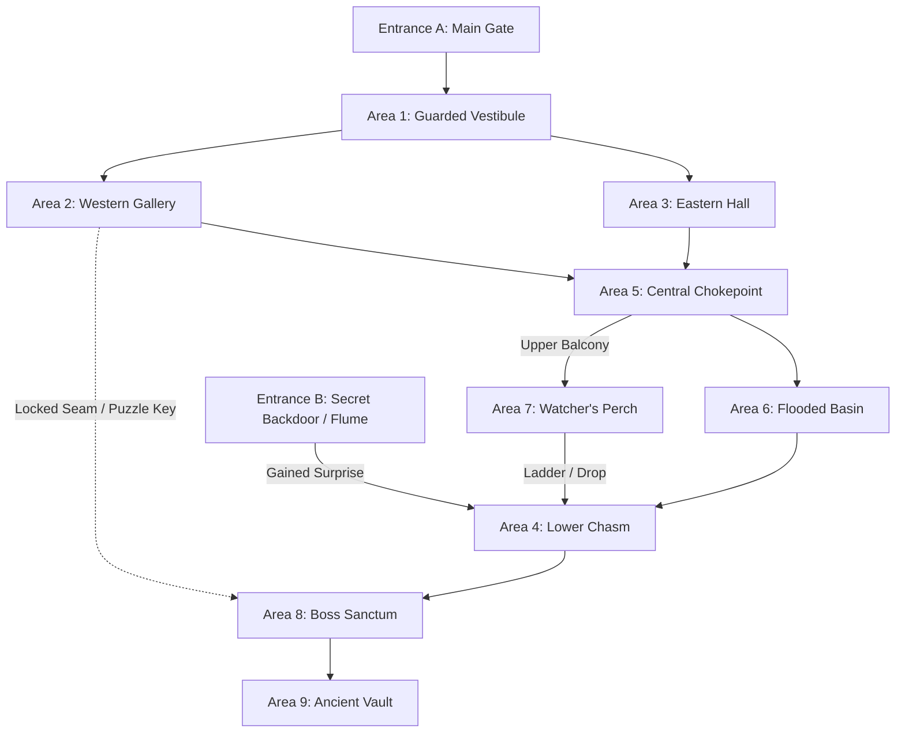

# One-Page Dungeon Engine: The Jaquayed Non-Linear Dungeon Framework

This skill automates the creation of high-agency, non-linear **One-Page Dungeons (OPDs)**. It synthesizes the visual density of the **One Page Dungeon Contest (OPDC)** with the spatial design principles of **Jennell Jaquays** (*Caverns of Thracia*, *Dark Tower*), codified by Justin Alexander as **"Jaquaying the Dungeon"**.

Unlike the linear, 3-act progression of the 5-Room Dungeon (which excels at tight 2-hour cinematic one-shots), the **One-Page Jaquayed Dungeon** prioritizes **player agency, strategic navigation, faction dynamics, and spatial problem-solving**.

---

## 1. Core Philosophy: Everything's a Dungeon & Enforced Order Jaquaying

### Everything's a Dungeon
Remember, **everything's a dungeon**—whether it's a small town, forest glade, abandoned farm, flooded sinkhole, or ruined mill. Any locale can be treated with 5-room dungeon pacing.

### Description, Locale, and Layout
* **Stage & Environment:** Set the tone, stage, and environment: terrain, lighting, ambience, flora, fauna, and the location’s history and current use (natural, wonder, ruin, or hybrid).
* **Single Consistent Encounter Space:** Whether it’s one large open area or several connected chambers, the layout should support **one consistent encounter**. Even if there are several enemy groups, it should be difficult to engage them completely independently—actions echo and alert adjacent areas, most often leading to one large, dynamic conflict. In a lair, base, or hideout, enemies actively use terrain to their tactical advantage.
* **No Wasted Background:** History and current use should be obvious from the description, from rumors, or discovered through exploration. **Don't bother writing a background that won't see gameplay, can't be discovered, or has no impact on the layout.**
* **Band Appropriate:** Locales and challenges must match the party's band tier (Greenhorns L1–3, Blooded L4–6).

### Enforced Order in Jaquayed Topologies
A Jaquayed dungeon is a **non-linear spatial web** rather than a branching tree or railroaded corridor. However, **order must still be enforced**:
* **Gating the Capstone:** Use maps with multiple ingress points and loops to avoid linear encounters, but use **locks, secrets, puzzles, riddles, spells, tricks, and traps to ensure the capstone of a quest doesn’t come first**.
* **Reward the Back Door:** Reward players for scouting and finding the best way to approach, like a "back door" or secret entrance that makes gaining surprise trivial.
* **Negative Space (Breathing Room):** Exploration is the continuous baseline. It never hurts to have spaces to search that don't always try to jump scare. Giving players room to inspect clues and breathe without immediate combat makes subsequent jump scares and combat spikes significantly more prominent.



### The 5 Laws of Jaquaying:
1. **Multiple Entrances (At least 2 Ingress/Egress Points):**
   - The party is never forced through a single choke-point bottleneck to enter or leave.
   - Example: A heavily barricaded front portcullis vs. an overgrown cliffside drainage pipe or natural ceiling sinkhole.
2. **Loops and Ring Corridors (At least 2 Complete Cycles):**
   - Pathways loop back on themselves, connecting rooms via multiple avenues.
   - Enables tactical flanking, hit-and-run tactics, retreating to rally, and stealth bypasses.
3. **Elevation & Verticality (3D Cross-Sections):**
   - Distinct elevation tiers: upper walkways, balconies overlooking lower caverns, dry ledges over flooded basins, vertical shafts, and natural sinkholes.
   - Creatures on higher tiers exploit natural cover and ranged asymmetry.
4. **Secret Shortcuts & Discontinuous Transitions:**
   - Hidden doors, movable flagstones, or drainage grates that connect early sectors directly to deeper sanctums, rewarding thorough perception and investigation.
5. **Dynamic Faction Mobility (Active Cross-Traffic):**
   - Because loops exist, adversaries do not stand still in isolated rooms. When alarms sound, patrol group A advances down the western gallery while group B loops through the eastern hall to pin the intruders in a pincer movement.

---

### The 6 Core 5-Room Flow Archetypes
Classic flow notation:
* **E** = Entrance
* **P** = Puzzle or roleplay challenge
* **S** = Setback or twist
* **B** = Big battle (Capstone conflict)
* **R** = Reward or revelation

```text
💠 LINEAR: E ──► P ──► S ──► B ──► R

🐓 ROOSTER:
      P
       \
  E ──► S ──► B
       /
      R

❌ CROSS:
      P
      │
  S ──E ── B
      │
      R

🕊️ FLYING V:
  B           R
   \         /
    S ───── P
         │
         E

🔀 DECISION:
        B
  E ──► P ──► S
        R

🔁 WRONG WAY:
  S ──► E ──► P ──► B ──► R
```

---

## 2. Information Architecture (The "Single-Screen" Scannable Format)

The One-Page format eliminates multi-paragraph narrative blocks. Every room entry is compressed into a **hyper-dense, bulleted operational block** that a DM can run entirely at a glance without reading walls of text.

### The Standard Room Block:
```markdown
### 03. The Sluice Cistern
- **Space:** 30x40 ft, 15-ft vaulted stone, floor knee-deep in murky brine.
- **Sensory:** Roar of churning water, copper smell of wet rust, freezing draft from ceiling fissure.
- **Features & Levers:**
  - *Drainage Grate:* Iron bars bowed by hydrostatic pressure; Athletics DC 13 to clear debris or [**7 (2d6) bludgeoning**](http://127.0.0.1:26796/roll?d=2d6&type=bludgeoning&label=Cistern+Backflow&cmd=dmg) backflow.
  - *Western Arch:* Open loop back into Area 02; stone steps descend south to Area 06.
  - *Secret Drain Tunnel:* Investigation DC 14 reveals a loose silt seam bypassing the portcullis into Area 08.
- **Occupants & Tactics:**
  - 2 **Bog Ghouls** (CR 1, AC 12, HP 22) lurking submerged under duckweeds.
  - *Reaction Roll ([🎲 2d6](http://127.0.0.1:26796/roll?d=2d6&dm=true&label=Cistern+Ghoul+Reaction)):* 2–7 attack, 8–10 stalk, 11–12 retreat down south steps.
  - 🩸 *Morale (≤ 11 HP):* Dive into the southern culvert to alert the wight in Area 06.
```

---

## 3. The Triad Architecture: 5-Room Pacing + Jaquayed Topology + The Hero's Journey of Injustice

An adventure achieves true emotional investment—it gains **"teeth"**—when players don't just clear rooms for gold, but **experience someone else's pain and visceral injustice, and become driven to right the wrong**.

The system synthesizes three layered design frameworks into a unified whole:

```
┌────────────────────────────────────────────────────────────────────────────────────────┐
│                        THE TRIAD ADVENTURE ARCHITECTURE                                │
├──────────────────────────┬─────────────────────────────┬───────────────────────────────┤
│ 1. SPATIAL TOPOLOGY      │ 2. PACING ENGINE            │ 3. THE EMOTIONAL SPINE        │
│ (Jaquaying the Dungeon)  │ (5-Room Functional Model)   │ (Hero's Journey of Injustice) │
├──────────────────────────┼─────────────────────────────┼───────────────────────────────┤
│ • Multiple Entrances     │ • Room 1: Entrance/Guardian │ • The Discovered Wound        │
│ • Loops & Ring Corridors │ • Room 2: Puzzle/Challenge  │ • Unmasking the Lie           │
│ • Verticality / Balconies│ • Room 3: Trick / Setback   │ • The Complicity Trap         │
│ • Secret Shortcuts       │ • Room 4: Climax / Ordeal   │ • Confronting the Martyr      │
│ • Dynamic Faction Pinch  │ • Room 5: Reward/Revelation │ • Restitution & The Road Back │
└──────────────────────────┴─────────────────────────────┴───────────────────────────────┘
```

### The 5 Emotional Milestones of the Injustice Spine:

#### 1. The Discovered Wound (Act I: Threshold & Inciting Proof)
- **The Setup:** The quest begins under a mundane or official pretense (sanitize a vault, retrieve a lost tool chest, repair a floodgate).
- **The Shock:** Passing the entrance threshold shatters the official narrative. The party encounters tangible, visceral proof of horrific human suffering: a gouged nameplate reading *"COWARD"*, weeping voices repeating dead homesteaders' names, or skeletons with warding spikes driven through their ribs.
- **The Hook:** The quest ceases to be about a paycheck; the players are confronted with a historic crime that cries out for justice.

#### 2. Unmasking the Lie (Act II: Tests & Trials Through the Loops)
- **The Exploration:** As the party navigates the spatial loops, puzzles, and environmental hazards, they uncover physical evidence of institutional betrayal.
- **The Evidence:** Sabotaged gears stamped with a founder's crest, forged treaties, or secret ledgers proving that the town's ruling authorities built their wealth on murder and stolen credit.
- **The Realization:** The players discover that their employers didn't hire them to fix a problem—they hired them as unwitting cleanup crews to erase evidence.

#### 3. Confronting the Martyr (Act III: The Inmost Cave & The Ordeal)
- **The Climax:** The "boss" of the dungeon is not a mustache-twirling villain, but a **tormented victim or bound oathkeeper** (Aveline entombed alive, Maeve pinned by an anchor, the Heartwood Woad guarding an alderman's dying wish).
- **The Catharsis Engine (d6 Lore Revelation Parley):**
  - When reduced to $\le$ 50% HP (or calmed via respectful dialogue and true names), combat pauses.
  - The entity breaks down in tears or righteous fury, delivering verbatim dialogue from the **d6 Lore Revelation Table**. They pour out the truth of their murder directly into player dialogue.
- **The Moral Pivot:** The players are given a profound choice: execute the victim to claim the corrupt bounty, or risk their lives to break the victim's chains and champion their cause.

#### 4. The Weapon of Truth & Restitution (The Seizing of the Sword)
- **The Reward:** Beyond gold, the central reward in Area 5 is the **instrument of legal or moral restitution**: the unedited founding charter, the secret timber ledger, or the true boundary grant signed in blood.
- **The Martyr's Blessing:** In gratitude, the cleansed spirit grants the party an enduring ancestral blessing before dissolving into peace.

#### 5. The Road Back & Resurrection (The Beneficiaries' Ambush)
- **The Confrontation:** The corrupt figures who profit from the lie (Council enforcers, crooked bailiffs, river wardens) ambush the party at their extraction point to confiscate the evidence and ensure the truth dies in the dark.
- **The Righteous Victory:** Defeating the ambushers, exposing their cowardice, or forcing them to flee cements the players as true folk heroes who didn't just survive a dungeon—they redeemed a piece of the world.

### The Mystery Engine: Discovery of Intent & Earned Conviction

If the truth is spoon-fed or declared by an NPC in the first room, the narrative feels shallow and unearned. True emotional investment requires **active forensic investigation and the progressive discovery of calculating intent**. When players deduce the conspiracy with their own minds, their righteous conviction carries real moral weight:

```
┌────────────────────────────────────────────────────────────────────────────────────────┐
│                        THE 3-TIER FORENSIC MYSTERY HIERARCHY                           │
├─────────────────────────┬──────────────────────────────┬───────────────────────────────┤
│ 1. THE FORENSIC ANOMALY │ 2. THE MODUS OPERANDI        │ 3. THE DISCOVERY OF INTENT    │
│ (Physical Contradiction)│ (The Mechanical Method)      │ (The Calculating Motive)      │
├─────────────────────────┼──────────────────────────────┼───────────────────────────────┤
│ • Pry marks on inside   │ • Warding spike is a siphon  │ • Stolen dynasty legitimacy   │
│ • Scorch marks run in   │ • Sluice wedged with crest   │ • Port silts up if freed      │
│ • Barbed thorns, not axe│ • Double-entry tax ledgers   │ • Skimming 40% timber profits │
│ Action: [Search]        │ Action: [Study]              │ Action: [Influence] & Parley  │
│ "Someone is lying."     │ "This was an execution."     │ "We are the reckoning."       │
└─────────────────────────┴──────────────────────────────┴───────────────────────────────┘
```

#### The 3 Investigative Tiers:
1. **Tier 1: The Forensic Anomaly (Physical Fact — `[Search]`):**
   - A physical contradiction that directly disproves the employer's official cover story.
   - *Examples:* Pry marks on the *inside* of a marble sarcophagus while iron straps are bolted from the *outside*; cinerary urns overturned from within; logging draft horses killed by thorny spines rather than wild beasts.
   - *Player Deduction:* *"The official story is a complete fabrication."*
2. **Tier 2: The Modus Operandi (The Method — `[Study]`):**
   - Uncovering the mechanical or arcane engineering used to commit and conceal the betrayal.
   - *Examples:* Necrotic glyphs proving the warding spike channels soul energy into town foundations; drainage valves intentionally wedged shut with iron chisels bearing the founder's personal stamp; secret double-entry ledgers hidden behind false coffer panels.
   - *Player Deduction:* *"This wasn't a tragedy or accident—it was a premeditated institutional execution."*
3. **Tier 3: The Discovery of Intent (The Motive — `[Influence]` & Lore Parley):**
   - Unmasking the cold economic or political motive behind the crime through environmental documents and the **d6 Lore Parley Engine**.
   - *Examples:* The founder buried his partner alive to steal the settlement's charter rights for his lineage; the Council keeps the drowned warden chained because releasing her turns their artificial deep-water harbor back into mud flats; Lady Korena sent loggers to burn her husband's treaty to protect her timber monopoly.
   - *Player Deduction:* *"Our employer hired us as unwitting janitors to bury their guilt. We will not be their cleanup crew."*

#### The 3-Clue Redundancy Rule (Alexander):
For every critical deduction, embed at least **3 distinct clues** across different chambers and action lenses (one physical anomaly, one written/mechanical record, and one creature reaction). Investigation never grinds to a halt on a single failed d20 roll; checks determine the *speed and detail* of deduction, never access to the clue itself.

---

## 4. Cartography & Map-First Workflow (Neutral Party Benchmark)

Like `hollow-reach-builder`, every Jaquayed One-Page Dungeon is built using the **Map-First Principle**:

1. **Prompting the Map with Built-in Loops:**
   - Explicitly instruct `image-generator` to include **at least two interconnected loop corridors** and a **secondary entrance**:
   ```text
   Generate a pure 90-degree orthogonal overhead top-down D&D tabletop battlemap of a multi-path dungeon ruin:
   - STRICTLY 90-DEGREE TOP-DOWN ORTHOGONAL BIRD'S-EYE VIEW (ZERO TILT).
   - Neutral Party cartography style: earthy muted stone, dark moss, water channels, natural loam.
   - LAYOUT MUST FEATURE NON-LINEAR LOOPS:
     * Entrance A (North): Stone arched entry stairs.
     * Entrance B (West): Natural sinkhole/drainage cave.
     * Central Loop: Main hall connects to both eastern barracks and western crypts, which both loop around to a central cistern.
     * Secret Passage: A narrow cracked stone seam connecting the western crypt directly to the lower sanctum.
   - Pure black exterior void, gridless, textless, 16:9 ratio (1400x800 px).
   ```
2. **Unified Ingress-Dungeon-Egress Canvas:**
   - The battlemap must render both exterior approaches (Entrance A and Entrance B) on the same canvas as the interior complex, allowing full session tracking on a single AboveVTT scene.
3. **Integer Grid Pitch (50 px Standard):**
   - Resize/normalize canvas to exact multiples of 50 px (e.g. 1400 × 800 px = 28 × 16 squares).
   - Zero offset `(0, 0)` in AboveVTT.

---

## 5. AboveVTT Turnkey Integration Standard

When compiling the companion `.abovevtt` package for an OPD:

1. **Default-Hidden Tokens:**
   - **ALL** creature tokens, adversaries, and sentries MUST be placed with `"hidden": true`.
   - The DM decides when to unhide tokens based on lighting, stealth rolls, and line of sight.
2. **Lightweight Vision & Doors:**
   - Draw simple, clean gridline-centered lines for major perimeter walls, closed doors, and secret passages.
   - Do not over-engineer micro-details; keep line count lean to avoid WebGL lag.
3. **Interactive D&D Beyond Statblocks:**
   - Every creature has an interactive HTML note with clickable roll buttons (`avtt-roll-button`).
4. **Interactive Markdown Rollers:**
   - All traps, environmental damage cards (`cmd=dmg`), hazard durations, and reaction/morale rolls (`dm=true`) use clickable local runner links (`http://127.0.0.1:26796/roll?...`).

---

## 6. Summary Cheat Sheet: When to Use Which Framework

| DM Goal | Recommended Engine |
| :--- | :--- |
| **Paced 2-to-4 Hour One-Shot** with a strong cinematic mystery, dramatic twist, and scripted narrative climax. | **`hollow-reach-builder`** (5-Room / Three-Act Structure) |
| **High-Agency Exploration, Faction Warfare, or Infiltration** where players scout multiple routes, bypass choke-points, and trigger dynamic flanking maneuvers. | **`one-page-dungeon`** (Jaquayed Non-Linear Topology) |
