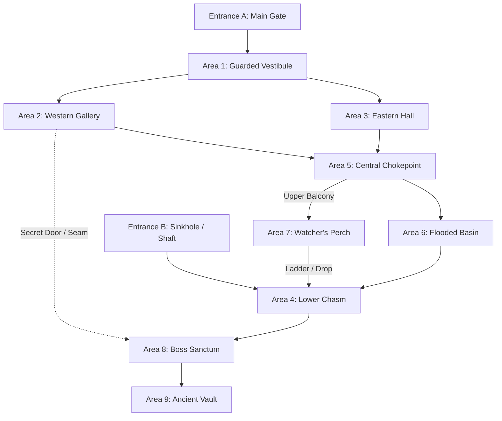

# One-Page Dungeon Engine: The Jaquayed Non-Linear Dungeon Framework

This skill automates the creation of high-agency, non-linear **One-Page Dungeons (OPDs)**. It synthesizes the visual density of the **One Page Dungeon Contest (OPDC)** with the spatial design principles of **Jennell Jaquays** (*Caverns of Thracia*, *Dark Tower*), codified by Justin Alexander as **"Jaquaying the Dungeon"**.

Unlike the linear, 3-act progression of the 5-Room Dungeon (which excels at tight 2-hour cinematic one-shots), the **One-Page Jaquayed Dungeon** prioritizes **player agency, strategic navigation, faction dynamics, and spatial problem-solving**.

---

## 1. Core Philosophy: The Jaquayed Topology

A Jaquayed dungeon is a **non-linear spatial web** rather than a branching tree or railroaded corridor. If the party encounters an impassable door, deadly trap, or overwhelming monster, they never hit a dead end—they can always **circle around, flank, or bypass**.



### The 5 Laws of Jaquaying:
1. **Multiple Entrances (At least 2 Ingress/Egress Points):**
   - The party is never forced through a single choke-point bottleneck to enter or leave.
   - Example: A heavily barricaded front portcullis vs. an overgrown cliffside drainage pipe or natural ceiling sinkhole.
2. **Loops and Ring Corridors (At least 2 Complete Cycles):**
   - Pathways loop back on themselves, connecting rooms via multiple avenues.
   - Enables tactical flanking, hit-and-run tactics, retreating to rally, and stealth bypasses.
3. **Elevation & Verticality (3D Cross-Sections):**
   - Distinct elevation tiers: upper walkways, balconies overlooking lower caverns, dry ledges over flooded basins, vertical shafts, and natural sinkholes.
   - Creatures on higher tiers exploit natural cover and ranged asymmetry.
4. **Secret Shortcuts & Discontinuous Transitions:**
   - Hidden doors, movable flagstones, or drainage grates that connect early sectors directly to deeper sanctums, rewarding thorough perception and investigation.
5. **Dynamic Faction Mobility (Active Cross-Traffic):**
   - Because loops exist, adversaries do not stand still in isolated rooms. When alarms sound, patrol group A advances down the western gallery while group B loops through the eastern hall to pin the intruders in a pincer movement.

---

## 2. Information Architecture (The "Single-Screen" Scannable Format)

The One-Page format eliminates multi-paragraph narrative blocks. Every room entry is compressed into a **hyper-dense, bulleted operational block** that a DM can run entirely at a glance without reading walls of text.

### The Standard Room Block:
```markdown
### 03. The Sluice Cistern
- **Space:** 30x40 ft, 15-ft vaulted stone, floor knee-deep in murky brine.
- **Sensory:** Roar of churning water, copper smell of wet rust, freezing draft from ceiling fissure.
- **Features & Levers:**
  - *Drainage Grate:* Iron bars bowed by hydrostatic pressure; Athletics DC 13 to clear debris or [**7 (2d6) bludgeoning**](http://127.0.0.1:26796/roll?d=2d6&type=bludgeoning&label=Cistern+Backflow&cmd=dmg) backflow.
  - *Western Arch:* Open loop back into Area 02; stone steps descend south to Area 06.
  - *Secret Drain Tunnel:* Investigation DC 14 reveals a loose silt seam bypassing the portcullis into Area 08.
- **Occupants & Tactics:**
  - 2 **Bog Ghouls** (CR 1, AC 12, HP 22) lurking submerged under duckweeds.
  - *Reaction Roll ([🎲 2d6](http://127.0.0.1:26796/roll?d=2d6&dm=true&label=Cistern+Ghoul+Reaction)):* 2–7 attack, 8–10 stalk, 11–12 retreat down south steps.
  - 🩸 *Morale (≤ 11 HP):* Dive into the southern culvert to alert the wight in Area 06.
```

---

## 3. Cartography & Map-First Workflow (Neutral Party Benchmark)

Like `hollow-reach-builder`, every Jaquayed One-Page Dungeon is built using the **Map-First Principle**:

1. **Prompting the Map with Built-in Loops:**
   - Explicitly instruct `image-generator` to include **at least two interconnected loop corridors** and a **secondary entrance**:
   ```text
   Generate a pure 90-degree orthogonal overhead top-down D&D tabletop battlemap of a multi-path dungeon ruin:
   - STRICTLY 90-DEGREE TOP-DOWN ORTHOGONAL BIRD'S-EYE VIEW (ZERO TILT).
   - Neutral Party cartography style: earthy muted stone, dark moss, water channels, natural loam.
   - LAYOUT MUST FEATURE NON-LINEAR LOOPS:
     * Entrance A (North): Stone arched entry stairs.
     * Entrance B (West): Natural sinkhole/drainage cave.
     * Central Loop: Main hall connects to both eastern barracks and western crypts, which both loop around to a central cistern.
     * Secret Passage: A narrow cracked stone seam connecting the western crypt directly to the lower sanctum.
   - Pure black exterior void, gridless, textless, 16:9 ratio (1400x800 px).
   ```
2. **Unified Ingress-Dungeon-Egress Canvas:**
   - The battlemap must render both exterior approaches (Entrance A and Entrance B) on the same canvas as the interior complex, allowing full session tracking on a single AboveVTT scene.
3. **Integer Grid Pitch (50 px Standard):**
   - Resize/normalize canvas to exact multiples of 50 px (e.g. 1400 × 800 px = 28 × 16 squares).
   - Zero offset `(0, 0)` in AboveVTT.

---

## 4. AboveVTT Turnkey Integration Standard

When compiling the companion `.abovevtt` package for an OPD:

1. **Default-Hidden Tokens:**
   - **ALL** creature tokens, adversaries, and sentries MUST be placed with `"hidden": true`.
   - The DM decides when to unhide tokens based on lighting, stealth rolls, and line of sight.
2. **Lightweight Vision & Doors:**
   - Draw simple, clean gridline-centered lines for major perimeter walls, closed doors, and secret passages.
   - Do not over-engineer micro-details; keep line count lean to avoid WebGL lag.
3. **Interactive D&D Beyond Statblocks:**
   - Every creature has an interactive HTML note with clickable roll buttons (`avtt-roll-button`).
4. **Interactive Markdown Rollers:**
   - All traps, environmental damage cards (`cmd=dmg`), hazard durations, and reaction/morale rolls (`dm=true`) use clickable local runner links (`http://127.0.0.1:26796/roll?...`).

---

## 5. Summary Cheat Sheet: When to Use Which Framework

| DM Goal | Recommended Engine |
| :--- | :--- |
| **Paced 2-to-4 Hour One-Shot** with a strong cinematic mystery, dramatic twist, and scripted narrative climax. | **`hollow-reach-builder`** (5-Room / Three-Act Structure) |
| **High-Agency Exploration, Faction Warfare, or Infiltration** where players scout multiple routes, bypass choke-points, and trigger dynamic flanking maneuvers. | **`one-page-dungeon`** (Jaquayed Non-Linear Topology) |
